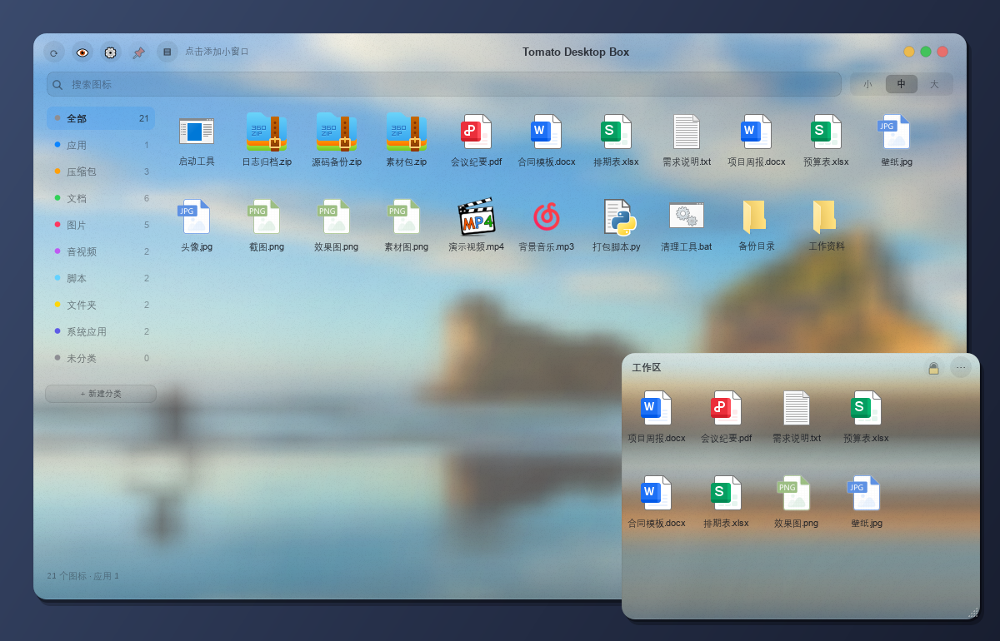

# Tomato Desktop Box



桌面图标收纳面板 —— 相当于第二个桌面。双击 `DeskBox.bat` 启动。当前版本 **2.2.2**。

**Tomato Desktop Box 不会移动、复制或删除你桌面上的任何文件。**

它做的事只有三件：读桌面、记分组、帮你把桌面图标藏起来。
分组关系写成一份账本（`%APPDATA%\DeskBox\groups.json`），文件一直待在原来的位置。
需要复制 / 剪切 / 看属性时，走系统自己的右键菜单；重命名由 Tomato Desktop Box 自己做（就地改名，不动位置）。

## 用法

| 操作 | 说明 |
|---|---|
| 双击图标 | 打开 |
| 右键图标 | 打开 / 在资源管理器中显示 / **重命名** / 删除到回收站 / **更多操作 ▸**（系统原生菜单）/ **移到分类 ▸** / 复制路径 / **移除这个图标** |
| 右键图标 → 移除这个图标 | 只把这一项从面板上拿掉，**文件原地不动**；侧栏会多出一档「已移除」，在那里面右键就变成「放回面板」，随时能放回来。找不到了就点底栏「一键导入桌面」——它会把缺的列出来，确认一次全导回来 |
| 已移除档里右键 → 彻底移除图标 | 连「已移除」档里也不再露面（二次确认，提示里写明文件还在原处）；名单进 `ui.json` 的 `gone` 键，文件从头到尾没动过。想找回来：把它从桌面再拖进面板一次（重新拖入会自动撤销移除 / 彻底移除） |
| 右键图标 → 重命名 | 就地改名，只改名字不移动文件；快捷方式的 `.lnk` 后缀不会丢，分组记录跟着新名字走 |
| 右键空白处 | 桌面背景的原生右键菜单（查看 / 排序 / **新建** / 粘贴 / 显示设置），跟右键桌面本体一样；新建出来的文件直接落在桌面，面板里立刻出现 |
| 右键顶栏 / 工具栏 / 底栏的空白处 | 同上，也是桌面背景菜单（按钮和滑块上不弹） |
| **拖图标到左侧分类** | 只改分组记录，文件不动；拖到「全部」不动作 |
| **网格内拖图标换位** | 把一个图标拖到另一个图标上 = 两者对调位置；拖到网格空白处 = 移到末尾。多选时整块按原相对顺序挪过去。只是界面顺序，存进 `ui.json` 的 `order` 键，**不改分组账本、不动文件**；每个分类各记各的顺序 |
| **从桌面拖进来** | 只在面板里登记分组，文件留在桌面原处 |
| **从别的地方拖进来**（资源管理器任意目录 / U 盘 / 快捷方式） | 一样登记分组，网格里立刻出现（文件名取真实名，文件仍留在原处）；拖错了就在「更多操作 ▸」里删掉账本记录 |
| **一键导入桌面** | 把桌面上的图标都收进面板：**桌面文件全在**就提示「桌面文件已经全部在了」；**缺了哪个**（被移除 / 彻底移除的）就把名字列出来，确认后导入，并弹提示「导入成功：N 个文件已经回到面板上了」；顺带按扩展名给还没分组的图标写分组记录。全程文件原地不动，鼠标悬停按钮有同一句提示 |
| 重置分组 | 清空全部分组记录，文件原地不动（二次确认） |
| 👁 | 隐藏 / 显示桌面图标（文件一个都不动） |
| 📌 | 置顶开关（默认关） |
| ▤ | 小窗口（▤ 右边写着「点击添加小窗口」）：左键 / 右键都弹出小窗口菜单 —— 列表里打勾 ✓ 的表示正开着，点一下切换开关，末尾「新建小窗口…」。小窗口互相靠近会自动吸附贴死（并排 / 上下 / 齐平 / 拐角都吸），拉尺寸时贴着的邻居跟着一起挪，拉到跟邻居一样长 / 一样宽会吸住顿一下，靠近屏幕上下左右边也会吸住；这个自动吸附可以在 ⚙ 设置 → 小窗口自动粘连 里关掉（默认开；关掉之后拖动 / 拉尺寸都不吸，也不再推开贴着的邻居）；主面板关掉时小窗口跟着一起收起来，下次打开主面板它们原样回来 |
| 底栏「透明度」滑块 | 往右更透（0 = 最实，100 = 最透）；存进 ui.json 的仍是 density 0–100 |
| ⚙ 设置 → 背景 | 左边六块文字底着色块（背景 / 开机自启动 / 最小化到托盘 / 点关闭 / 小窗口自动粘连 / 任务栏透明）等宽等高、文字居中，不再贴着字挤成一小块。五档：**玻璃**（默认，实时透出模糊壁纸）/ **黑玻璃**（同样透壁纸，但压成一层暗色相，像 Win11 的悬浮分组卡片）/ **深色**（冷灰，完全不透壁纸）/ **浅色**（近白）/ **纯色**（自己挑一个颜色，透明度直接换算成不透明度 —— 滑块拉到 100 就是整块全透明，只剩图标浮在桌面上；旁边的小色块点开是系统取色器。文字配色按底色亮度自动反转：**深色底白字、浅色底黑字**，弹窗提示也一起跟着换） |
| ⚙ 设置 → 开机自启动 | 打开设置时**现读**注册表 `HKCU\Software\Microsoft\Windows\CurrentVersion\Run` 里的「Tomato Desktop Box」值，本地不另存开关；切换就写进去 / 删掉，写完**再读一次**回显「已开启 / 已关闭」，读回来跟操作对不上（多半被安全软件拦住）就提示「写入失败」。这是 Tomato Desktop Box 唯一会写注册表的地方。写进去的命令是 `"…\Tomato Desktop Box.exe" --tray`：**开机自启动进来的这一份只收在通知区，不弹主面板**（桌面上的小窗口照常开回来）；手动双击 exe 不带这个参数，照旧弹面板 |
| ⚙ 设置 → 最小化到托盘 | 默认开：开着且系统有通知区时，点黄点是把面板收进通知区（不占任务栏）；关掉或没有通知区，黄点还是最小化到任务栏。通知区用不了时绝不把面板藏起来 |
| ⚙ 设置 → 点关闭 | 只管**主面板**两档：**收进托盘**（默认 —— 关掉后程序还在通知区，点一下就能把面板叫回来，**小窗口一个都不动**，照旧开在桌面上）/ **退出**（老样子真退出，小窗口跟着一起收起来）。没有通知区或 tray 模块缺失时，不管选哪档都按「退出」走 —— 绝不留下一个点不回来的程序 |
| ⚙ 设置 → 任务栏透明 | 三档 **磨砂 / 透明 / 关**，**默认关**（不想要就永远别开）。见下面「任务栏透明」一节 |
| 通知区图标 | 左键点一下收起 / 放出面板；右键菜单六项固定：**显示主面板**（只显不隐）/ **显示全部小窗口** / **隐藏全部小窗口**（把露着的窗口全收起来，**不是删除** —— 账本里照旧记着，点「显示全部小窗口」原样回来）/ **任务栏透明 ▸**（磨砂 / 透明 / 关，当前档打勾）/ **设置** / **退出**。退出会连小窗口一起关 |
| 程序图标 | 窗口、任务栏、通知区都用 `deskbox/appicon.py` 画的番茄图标（16 到 256 七档）；图标文件缺失或损坏时自动降级画一个，不会出现空白图标 |
| 双击标题栏或底栏的空白处 | 最大化；最大化后同样位置再双击还原 |
| 右键左侧分类 | 新建分类… / 删除分类…（删除后该分类的图标自动落到「未分类」，文件不动） |
| **系统应用** 分类 | 系统自带图标（此电脑 / 回收站）只在这里出现，不进「全部」；不能改分类、不能删、不能定位 |
| 左侧分类列表下方的「+ 新建分类」 | 点一下直接新建分类；分类太多挤掉这块时会自动隐藏 |
| ⟳ / ⚙ | 刷新 / 设置 |
| 左侧「已移除」档 | 只有在有货时才出现（插在「未分类」之前）；只是面板名单，`ui.json` 的 `removed` 键，文件从没被动过 |
| 右上三个圆点 | 从左到右：最小化（黄）/ 放大（绿）/ 关闭（红）；黄点跟着 ⚙ 设置 → 最小化到托盘 走，红点跟着 ⚙ 设置 → 点关闭 走（默认都是收进托盘，见上面几行） |

显示规则：快捷方式与程序的 `.lnk .url .exe .appref-ms` 后缀在界面上隐去（真实文件名不变），
名字过长自动换两行，鼠标悬停看完整名。图片文件直接显示缩略图。

桌面目录有变化时会自动重扫（`deskbox/watch.py` 里 400ms 去抖 + 3s 轮询兜底），
顶栏 ⟳ 也能立刻手动刷新。

## 小窗口

顶栏 📌 右边的 **▤** 是「小窗口」—— 桌面上的一小块浮窗，只放你挑出来的几个图标。

- **新建**：点 ▤ 弹菜单，选末尾「新建小窗口…」，立刻出现一个 340×280 的小窗口（位置自动错开，且**不会压到已有的小窗口**）。新建后会先露在最上面约 2.5 秒方便你拖位置，随后自动沉回桌面那一层
- **挪位置**：按住小窗口顶栏（含标题文字那一段）拖；点 🔒 或 ··· 不会误拖，位置会记进 minis.json
- **放图标**：从资源管理器 / 桌面 / 主面板拖进去 —— 拖进来的图标**立刻显示**，同时自动登记进主面板（两边都看得到，文件原地不动）；小窗口里也能把一个图标拖到另一个上换位（顺序存 `ui.json` 的 `order` 键，键名是 `mini:<窗口id>`）
- **点击选中**：点一下图标会出现浅色底表示选中；双击打开、点网格空白处、点到别的程序上（窗口失活）时选中底会自动退掉，不会一直留着
- **改名字**：双击小窗口左上角标题（双击顶栏空白处同样生效）
- **固定位置 / 大小**：小窗口顶栏 🔒 是「固定位置」（**新建的小窗口默认关**，顶栏直接就能拖；点一下变 🔒 就锁住，锁住后顶栏拖不动，改大小照样能改）；**四条边加右下角都能拉着改大小** —— 左 / 左下 / 下 / 右下 / 右，拖哪条边就只动哪条边，对面那条边钉死在原地；右键顶栏或右键图标 → 图标大小（小 / 中 / 大，跟主面板共用同一个档位）
- **收起来**：点小窗口右上角 ··· → 关闭这个小窗口 —— 窗口消失但**记录还在**，下次点 ▤ 菜单里能再打开，位置尺寸原样还原。**关机 / 注销 / 托盘「退出」不会把小窗口记成关闭**，下次开机照样开回来；只有自己点「关闭这个小窗口」（或 ▤ 菜单里把它切掉）才会记住关闭
- **永远待在桌面这一层**：小窗口是当桌面挂件用的 —— 不置顶，而且始终压在 Z 序最底下，**点它也不会盖到别的程序上面**（Qt 的「永远在最底层」标志 + 每次显示 / 被激活都再 SetWindowPos(HWND_BOTTOM) 压回去）；主面板照旧在最上面。只有「刚新建出来那 2.5 秒」是例外，方便你抓住它拖位置
- **小窗口之间不会互相压住**：移动松手 / 新建落位时会自动检测重叠，沿重叠较少的那条轴把窗口推开，最多试 8 轮直到不再相交，推完照旧磁吸贴死并夹回屏幕。这个避让跟「小窗口自动粘连」开关无关 —— 关掉粘连也照样避让重叠
- **永远不占任务栏**：小窗口**不会**在任务栏（也不会在 Alt+Tab）留按钮 —— 去掉 WS_EX_APPWINDOW、加上 WS_EX_TOOLWINDOW，玻璃需要的 WS_EX_LAYERED 留着；主面板照旧有任务栏按钮，互不影响。要收起小窗口用主面板 ▤ 的「小窗口」菜单，或托盘菜单的「隐藏全部小窗口」一键全收（只收不删，再点「显示全部小窗口」原样回来）
- **彻底删掉**：点顶栏 ··· → 删除这个小窗口，或右键顶栏 → 删除这个小窗口（二次确认）
- **顶栏 ···**：小窗口右上角是一个 ··· 按钮，点开只有两项：「关闭这个小窗口 / 删除这个小窗口」—— 原来三个交通灯的位置，现在归它
- **关主面板**：点主面板红点会把小窗口一起关掉（记录都还在，下次开程序照旧恢复）。只想收起主面板时点黄点最小化，别关它
- **主面板收起来怎么找回来**：在任一小窗口里右键顶栏 → 打开主面板；全部小窗口都收起来时，重新双击 `DeskBox.bat` 会从上次的状态恢复
- 小窗口里右键图标 = 跟主面板完全一样的菜单，末尾多一条「从小窗口移除」（只是从窗口里拿掉，文件不动）
- 从小窗口往资源管理器拖**不会**搬任何文件（拖出去只带内部标记，不带文件路径）

小窗口清单存在 `%APPDATA%\DeskBox\minis.json`，里面只有路径字符串。**它不动任何文件。**

## 「系统应用」分类

左侧「未分类」之前多了「系统应用」，里面是系统自带图标：**此电脑**、**回收站**。

- 只在「系统应用」里显示，**不进「全部」**，也不参与一键导入桌面、不写进分组账本
- 双击照常打开；「更多操作 ▸」走系统原生菜单（属性 / 打开方式 等）
- 不能改分类、不能送回收站、不能在资源管理器里定位 —— 它们不是文件
- 这一栏由 `deskbox/sysitems.py` 提供；模块没装时整栏自动消失，其余功能照常

## 数据放在哪

- 分组账本：`%APPDATA%\DeskBox\groups.json`（键是文件绝对路径，值是中文分类名）
- 窗口状态：`%APPDATA%\DeskBox\ui.json`（位置 / 尺寸 / density（透明度换算前的原值） / 置顶（默认关） / 背景 / 纯色档的底色 / 图标大小 / 小窗口自动粘连开关 / 任务栏透明档位 `tb_mode` / 已移除名单 / 界面顺序表 `order`）。`order` 是可选新键（`main:<分类名>` 与 `mini:<窗口id>` 两张表），只影响图标在网格里的先后，旧 `ui.json` 没有这个键照常跑；它跟分组账本无关，删掉也只是恢复默认排序
- 自定义分类：`%APPDATA%\DeskBox\cats.json`（只记新建 / 删除过哪些分类）
- 小窗口清单：`%APPDATA%\DeskBox\minis.json`（窗口标题 / 位置 / 尺寸 / 固定位置 / 是否打开 / 图标路径）
- 运行日志：`%APPDATA%\DeskBox\deskbox.log`（只在异常时写入，排障用）
- ⚙ 设置里能看到分组账本的完整路径，并有「打开目录」按钮

旧的「收纳根目录」（`C:\Users\Administrator\DeskBox\`）与 `manifest.json` 是上一版真搬文件
留下的历史遗留物，现在已经清理干净（备份在 `_probe/legacy_backup/`），新版不再使用。

## 「一键导入桌面」到底做了什么

先拿**桌面实扫到的全部条目**跟**面板现在显示的**对一遍：

- 没有缺项 → 弹提示「桌面文件已经全部在了」，同时给还没分组记录的图标算分类，往 `groups.json` 里写一行
- 有缺项（之前「移除这个图标」/「彻底移除图标」弄掉的）→ 确认框里把文件名一个个列出来（超过 8 个显示前 8 个 + 共几个），点「导入」才把它们放回来，点「取消」原样不动
- **只比对桌面上真实存在的文件**：从资源管理器别处拖进来登记的那些（不在桌面上）不算缺项，也不会出现在提示里

- 不移动、不复制、不删除、不改属性
- 桌面上的图标**一个都不会消失**
- 公共桌面（`C:\Users\Public\Desktop`）的条目一样只是登记
- 想撤销就点「重置分组」，或者把某个图标拖到别的分类

## 隐藏桌面图标

点顶栏 👁，第一次会弹一次说明，之后直接切。

- 原理是向桌面的 `SHELLDLL_DefView` 发 `WM_COMMAND`，等同于「桌面右键 → 查看 → 显示桌面图标」
- 隐藏后文件仍在原位，只是桌面上看不见
- 恢复：桌面右键 → 查看 → 显示桌面图标，或再点一次 👁
- Tomato Desktop Box 被强制关闭时桌面会保持隐藏，用上面第一种方式恢复
- 启动时如果检测到桌面处于隐藏状态，Tomato Desktop Box 只会问你一句要不要显示，绝不自动改；
  框里勾上「以后不再提示」之后就再也不问了，直接按你上次的选择保持原样

## 安全约束

- 「删除到回收站」走 `SHFileOperationW` + `FOF_ALLOWUNDO`，不直接抹盘，删完可在回收站还原
- 这是 Tomato Desktop Box 唯一会真正动文件的入口，且每次都有确认框
- 复制 / 剪切 / 属性一律交给系统原生菜单，Tomato Desktop Box 不碰；重命名由 Tomato Desktop Box 自己实现（deskbox/ui_mock.py 的 _rename → store.rename）
- 「任务栏透明」只改任务栏窗口的观感（一次 `SetWindowCompositionAttribute`，见 `deskbox/taskbarfx.py`），不动任何文件、不写注册表、不注入进程；退出 / 关闭时可一键还原成系统默认，另有 `ResetTaskbar.exe` 兜底

## 任务栏透明

Win10 的任务栏能改成磨砂或者全透，盒子把这件事收进来了 —— 不用再单独装 TranslucentTB 之类的小工具（两个程序同时改任务栏会互相覆盖，只留一个）。

- 开关在 **⚙ 设置 → 任务栏透明**，也可以在**通知区图标右键 → 任务栏透明 ▸** 里切。三档：
  - **磨砂**（acrylic，半透 + 底下一层模糊）
  - **透明**（全透，只留图标和文字）
  - **关**（默认，跟没装过一样）
- 默认**关**。不想用就一直关着，程序启动时只会把「你上次选的那档」重新贴上去；选的是「关」就什么都不做。
- 原理是给任务栏窗口发 `SetWindowCompositionAttribute`（`WCA_ACCENT_POLICY`），**不注入进程、不装 DLL、不起定时器**，也不改任何注册表值。一次下发就完事，实测置好之后最大化 / 还原 / 切前台 / 静置都不会自己退回去。
- **只动任务栏的观感，不碰窗口、不碰桌面图标、更不碰你的文件。**
- 只支持 **Windows 10**（Win11 的任务栏换了实现，这招不管用；在那种机器上这一行会直接显示成不可用，托盘菜单里那项也是灰的）。
- 检测到 TranslucentTB 正在跑时，设置行会提示「两个程序会互相覆盖任务栏外观，只留一个就好」—— 盒子**不会**去关掉它。
- **兜底**：盒子要是被强行结束（任务管理器结束进程 / 崩溃），来不及还原，任务栏会停在透明或磨砂。压缩包里附了一个 **`ResetTaskbar.exe`**，双击就回到系统默认 —— 不依赖盒子、不依赖 Python、单独一个 9.5 MiB 的 exe，就是这个用途。它平时用不着，所以只在「任务栏怎么变不回去了」的时候点它。
- 从托盘菜单切的时候会顺手把设置面板里那一格同步过去，反之亦然，两边永远显示同一个档位。

## 单实例（只开一个）

盒子同一个时刻只允许跑一个 —— 再双击一次 exe（或 `DeskBox.bat`）不会起第二个进程，
而是把已经在跑的那个叫到前面来。

- **为什么**：起两个就等于两套主面板、两套小窗口、两个通知区图标，而且同时对同一份
  `%APPDATA%\DeskBox` 账本读写，迟早写坏。
- **怎么做的**：`deskbox/single.py` 用 Qt 的 `QLocalServer` / `QLocalSocket`（Windows 底下就是
  命名管道），**不起本地 TCP 端口、不写锁文件**。进程被强杀也不会留下死锁 —— 管道由系统在
  进程消失时回收，下次启动会先用 `removeServer()` 把可能的残留名字清掉再抢。
- **管道名**：`DeskBox-tomato-desktop-box-<8位hex>`，后缀是当前用户名的哈希，所以同一台机器上
  两个 Windows 用户各开各的，互不干扰。
- 抢不到也连不上（极罕见的竞态）时**降级成照常启动** —— 绝不会因为单实例检查把程序卡死或
  什么都不开。
- 命令行关掉正在跑的那个：`Tomato Desktop Box.exe --quit`（走的是托盘「退出」同一套收尾）。
- `--shot` / `--bg` / `--size` 这些自检参数走 `main()`，单实例检查照旧生效；直接 `MainWindow()`
  的测试不受影响。`single.py` 缺失时安静降级成「照常单开」。

## 打包成单文件 exe

不想在这台机器上装 Python、只想双击一个文件跑起来，用仓库根的 `build_exe.py` 打单文件 exe（主程序本机实测 45.7 MiB，首次启动 5–7 秒解包）。一次跑完出**两个**产物：`dist\Tomato Desktop Box.exe` 是主程序，`dist\ResetTaskbar.exe`（约 9.5 MiB）是任务栏兜底还原工具 —— 后者只 import ctypes / os / sys，跟主程序一起打，不要漏掉，不然「盒子被强杀」那条路就没有出路了。

    python build_exe.py            :: 产物 dist\Tomato Desktop Box.exe + dist\ResetTaskbar.exe
    python build_exe.py --clean    :: 先删 build\ 再打

前置只有两样：Python 3.14 + `pip install PySide6 pyinstaller`。`build\`、`dist\`、`*.spec`、`*.exe` 都在 `.gitignore` 里 —— **exe 不进仓库，谁要谁自己打**。脚本最后会打印包内布局、源码指纹和 exe 绝对路径，指纹那行用来核对手上的 exe 是哪份源码打的。

脚本里有两处别随手删，删了不报错、只是悄悄坏：

- `--add-data "assets\tomato.ico;assets"`：`deskbox/appicon.py` 是拿自己的 `__file__` 往上找 `assets/tomato.ico` 的。打不进去它不报错，会安静换成 QPainter 现画的简化番茄 —— 程序图标就不是你挑的那颗了。
- `--add-data "<deskbox 源码>;deskbox"` 加那一串 `--hidden-import`：`deskbox/` 是以数据文件进包的，PyInstaller 的静态分析看不见它内部的 import，所以 `ctypes.wintypes`、`winreg`、`zlib` 这类必须手工点名，少一个就是启动 ImportError（实测踩过：`cannot import name 'wintypes' from 'ctypes'`）。脚本最后会打开产物归档逐个数 `assets/tomato.ico` 和 `deskbox/*.py`，少一个直接构建失败。

打包后自检（离屏，不弹窗、不碰真实配置）：exe 是 `--noconsole` 的，正常跑没有 stdout/stderr，所以「离屏出图 + 重定向 stderr」最省事 —— 设 `QT_QPA_PLATFORM=offscreen`、把 `APPDATA` 与所有 `DESKBOX_*` 指向临时目录，再用 `Start-Process -Wait -PassThru` 跑 `--shot`；退出码 0、png 有字节数、stderr 里没有 Traceback 就算过。注意 PowerShell 的 `&` 调 GUI 程序**不会等**，要退出码必须用 `Start-Process -Wait -PassThru`；另外离屏没有字体目录，截图里中文会显示成方框，跟打包无关。

> 从旧的 `.bat` 启动换到 exe 之后，注册表里可能还留着旧的 `pythonw …DeskBox.pyw` 命令，⚙ 设置 → 开机自启动 会显示成「未启用」，**重新点一次开**即可（程序刻意不自动改写注册表）。

## 开发

```
deskbox/store.py     数据层：scan / classify / 打开 / 回收站 / 就地改名（搬移接口保留但界面不再调用）
deskbox/groupbook.py 分组账本：groups.json 读写
deskbox/hidedesk.py  隐藏 / 显示桌面图标
deskbox/shellmenu.py 系统原生右键菜单
deskbox/watch.py     桌面目录变化监测
deskbox/icons.py     Shell 256px 高清图标 + 图片缩略图
deskbox/glass.py     自绘玻璃：五档（玻璃 / 黑玻璃 / 深色 / 浅色 / 纯色），前两档实时透出模糊壁纸，纯色档 alpha 直接跟透明度走
deskbox/cats.py      分类表：默认 8 个分类 + 新建 / 删除的自定义分类
deskbox/sysitems.py  系统自带图标（此电脑 / 回收站）的 CLSID 表与可见性
deskbox/minibox.py   小窗口清单：minis.json 读写（只存路径）
deskbox/autostart.py 开机自启动：注册表 Run 值读 / 写 / 删（失败一律 False，不抛）
deskbox/tray.py      通知区图标与六项菜单（含隐藏全部小窗口、任务栏透明子菜单；没有通知区时全部空转）
deskbox/taskbarfx.py 任务栏外观：三档磨砂 / 透明 / 关（ctypes 直发 SetWindowCompositionAttribute，不注入）
ResetTaskbar.py      兜底：双击把任务栏还原成系统默认（不 import Qt，单独打成 9.5 MiB 的 exe）
deskbox/appicon.py   程序图标：七档尺寸 + 缓存 + 缺失降级画法
tests_minibox.py     小窗口清单单测（16 项）
tests_ui_210.py      界面接线单测（28 项，unittest 风格，离屏）
tests_tray.py        托盘菜单单测（17 项）
tests_taskbarfx.py   任务栏外观单测（19 项，全程离屏 + FakeBackend）
tests_resettaskbar.py 兜底程序单测（12 项，全程 mock）
tests_mini_drop.py   小窗口拖入：正斜杠路径归一化 / 图标能取到 / 同步进主面板账本（8 项）
tests_selection_clear.py  选中底色在双击 / 失活 / 点空白后退掉（6 项）
tests_mini_place.py  新建小窗口先露头再沉底 / 小窗口之间禁止重叠（8 项）
tests_settings_chip.py  设置里六个文字底块等宽等高、行内不越界（9 项）
tests_reorder.py     网格内拖动换位 + 顺序持久化（13 项）
deskbox/ui_mock.py   界面与交互
tests_store.py       数据层单测（187 项）
tests_groupbook.py   分组账本单测（88 项）
tests_cats.py        分类表单测（103 项）
tests_watch.py       桌面监测单测（32 项）
tests_sysitems.py    系统图标单测（62 项）
tests_bgmenu.py      桌面背景菜单单测（45 项）
tests_shellmenu.py   原生菜单单测（68 项）
_probe/              验证脚本与截图
build_exe.py         打包成单文件 exe（PyInstaller，见上面「打包成单文件 exe」）
```
